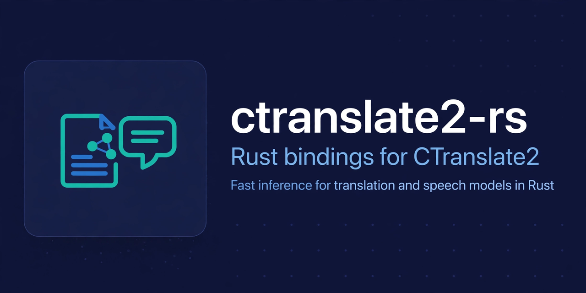

# ctranslate2-rs

[](https://crates.io/crates/ct2rs)
[](https://github.com/jkawamoto/ctranslate2-rs/actions/workflows/build.yaml)
[](https://docs.rs/ct2rs)
[](https://github.com/jkawamoto/ctranslate2-rs/blob/main/LICENSE)

This library provides Rust bindings for [OpenNMT/CTranslate2](https://github.com/OpenNMT/CTranslate2).

<div align="center">
  
  <small>The header image was generated with Muse (Muse Image).</small>
</div>

## Usage

### Prerequisites

[CMake](https://cmake.org/) and a C++ compiler are required to build the library from source. Some backends have
additional requirements; see [Features](#features).

### Installation

Add this crate to your `Cargo.toml` and select the backend features you want to use:

```toml
[dependencies]
ct2rs = { version = "0.10.4", features = ["cuda", "dnnl", "mkl"] }
```

Alternatively, use the `ct2rs-platform` crate to enable platform-specific default features:

```toml
[dependencies]
ct2rs = { version = "0.10.4", package = "ct2rs-platform" }
```

See [Features](#features) for details about the available features and their requirements.

### Basic usage

See the [examples](ct2rs/examples) for loading models and running inference. Models must first be converted to the
CTranslate2 format; see [Model Conversion for CTranslate2](#model-conversion-for-ctranslate2).

### Optional features

To use [Whisper](https://huggingface.co/docs/transformers/model_doc/whisper) models, enable the `whisper` feature.

### Raw bindings

The high-level API is provided by `ct2rs`. Raw bindings are available separately from
[`ct2rs-sys`](https://crates.io/crates/ct2rs-sys); `ct2rs` no longer exposes a `sys` module.
Add `ct2rs-sys` directly if you need the low-level API:

```toml
[dependencies]
ct2rs-sys = "0.10.3"
```

### Additional notes for Windows

When building on Windows, setting the environment variable `RUSTFLAGS=-C target-feature=+crt-static` might be required.

## Features

### Backend Features

- `cuda`: Enables CUDA support
- `cudnn`: Enables cuDNN support

The above features require setting `CUDA_TOOLKIT_ROOT_DIR` to the CUDA Toolkit installation directory
(for example, `/usr/local/cuda` on Linux).

- `mkl`: Enables [Intel MKL](https://www.intel.com/content/www/us/en/developer/tools/oneapi/onemkl.html) support
- `system-mkl`: Enables [Intel MKL](https://www.intel.com/content/www/us/en/developer/tools/oneapi/onemkl.html) support
  using the system-installed MKL library instead of downloading and building it
- `openblas`: Enables [OpenBLAS](https://www.openblas.net/) support (OpenBLAS needs to be installed manually
  via [vcpkg](https://vcpkg.io) on Windows)
- `dnnl`: Enables [oneDNN](https://www.intel.com/content/www/us/en/developer/tools/oneapi/onednn.html) support
- `ruy`: Enables [Ruy](https://github.com/google/ruy) support
- `accelerate`: Enables [Apple Accelerate](https://developer.apple.com/documentation/accelerate) support (macOS only)
- `openmp-runtime-comp`: Enables OpenMP runtime support
- `openmp-runtime-intel`: Enables OpenMP runtime support for Intel compilers
- `disable-cpu-dispatch`: Disables CPU kernel dispatching at runtime (should be set when explicitly targeting an
  architecture)

Multiple features can be enabled at the same time.

To enable Streaming SIMD Extensions 4.1 (SSE4.1), add the `-C target-feature=+sse4.1` flag to the `RUSTFLAGS` environment
variable.

By default, the `ct2rs` crate enables the `ruy` feature.

If you want to use platform-specific default features, use the `ct2rs-platform` crate.

### GPU-Specific Features

- `flash-attention`:
  Enables [Flash Attention](https://huggingface.co/docs/text-generation-inference/conceptual/flash_attention)
- `tensor-parallel`:
  Enables [Tensor Parallelism](https://huggingface.co/docs/text-generation-inference/conceptual/tensor_parallelism)
- `cuda-dynamic-loading`: Enables dynamic loading of CUDA libraries at runtime instead of static linking (requires
  CUDA >= 11)
- `cuda-small-binary`: Reduces binary size by compressing device code

### Tokenizer Features

- `sentencepiece`: Enables [SentencePiece](https://github.com/google/sentencepiece) tokenizer support
- `tokenizers`: Enables Hugging Face's [Tokenizers](https://github.com/huggingface/tokenizers) library support
- `all-tokenizers`: Enables both `sentencepiece` and `tokenizers` support

### Additional Features

- `whisper`: Enables [Whisper](https://huggingface.co/docs/transformers/model_doc/whisper) model support
- `hub`: Enables [Hugging Face Hub](https://huggingface.co/docs/hub) integration
- `system`: Uses the system-installed CTranslate2 shared library instead of building CTranslate2 from source (requires setting the
  appropriate environment variables to locate the CTranslate2 shared library)

### Platform-Specific Features

When `ct2rs-platform` is used, the following features are automatically selected based on the platform:

- Windows: `openmp-runtime-intel`, `dnnl`, `cuda`, `cudnn`, `cuda-dynamic-loading`, `mkl`
- Intel macOS: `dnnl`, `mkl`
- Apple Silicon macOS: `accelerate`, `ruy`
- Linux (non-ARM): `dnnl`, `openmp-runtime-comp`, `cuda`, `cudnn`, `cuda-dynamic-loading`, `mkl`, `tensor-parallel`
- Linux (ARM): `openmp-runtime-comp`, `openblas`, `ruy`

## Supported Models

The ct2rs crate has been tested and confirmed to work with the following models:

- BART
- BLOOM
- FALCON
- Marian-MT
- MPT
- NLLB
- GPT-2
- GPT-J
- OPT
- T5
- Whisper

See the [examples](ct2rs/examples) for usage examples.

## Streaming API

This crate also provides a streaming API using callbacks.
Please refer to the [example code](ct2rs/examples/stream.rs)
for more information.

## Model Conversion for CTranslate2

To use model files with CTranslate2, they must first be converted.
Below is an example of how to convert the `nllb-200-distilled-600M` model:

```shell-session
pip install ctranslate2 huggingface_hub torch transformers
ct2-transformers-converter --model facebook/nllb-200-distilled-600M --output_dir nllb-200-distilled-600M \
    --copy_files tokenizer.json
```

For more details, see the [CTranslate2 documentation](https://opennmt.net/CTranslate2/guides/transformers.html#nllb).

## Development

When using [mise](https://mise.jdx.dev/) in this repository, `sccache` is enabled by default for Rust and C/C++
compilation. Run `mise install` first. CTranslate2 and its dependencies are still built from source; cached compiler
outputs can speed up later builds. The first build with an empty cache may be slower.

mise builds use `target/sccache` to keep their CMake configuration separate from builds without sccache. To run a
build without sccache in a POSIX shell, use a separate target directory:

```sh
env -u RUSTC_WRAPPER -u CMAKE_C_COMPILER_LAUNCHER -u CMAKE_CXX_COMPILER_LAUNCHER \
  CARGO_TARGET_DIR=target/no-sccache cargo build -p ct2rs --release
```

Use the same target directory when switching back to cached builds only after reconfiguring CMake; otherwise its cached
compiler launcher settings may persist. `cargo clean` under mise only cleans the active `CARGO_TARGET_DIR`.
These settings are local development defaults and are not required for users of the published crate.

## License

This library is licensed under the MIT License. For details, see the [LICENSE](LICENSE) file.

[CTranslate2](https://github.com/OpenNMT/CTranslate2) (which `ct2rs-sys` builds and links to)
is licensed under MIT License.
If you redistribute binaries or source that include CTranslate2,
you must comply with the MIT terms, including preserving license and notice files.
For details, see CTranslate2’s upstream LICENSE/NOTICE.

The published `ct2rs-sys` crate may build and/or redistribute artifacts originating from the following third-party projects.
Each component remains under its own license, which applies in addition to this crate’s MIT license.
When redistributing your software,
ensure that you include the required attributions and license texts for any components
that were used by your build configuration and target platform.
The exact set of components used can depend on enabled features, target architecture, and toolchain.

The published `ct2rs-sys` crate also includes the following libraries:

BSD-2-Clause:

- [cpuinfo](https://github.com/pytorch/cpuinfo)

BSD-3-Clause:

- [CUTLASS](https://github.com/NVIDIA/cutlass)
- [GoogleTest](https://github.com/google/googletest)
- [cub](https://github.com/NVIDIA/cub)

Apache License 2.0:

- [cpu_features](https://github.com/google/cpu_features)
- [The ruy matrix multiplication library](https://github.com/google/ruy)
- [Thrust: Code at the speed of light](https://github.com/NVIDIA/thrust)

MIT License:

- [cxxopts](https://github.com/jarro2783/cxxopts)
- [spdlog](https://github.com/gabime/spdlog)
